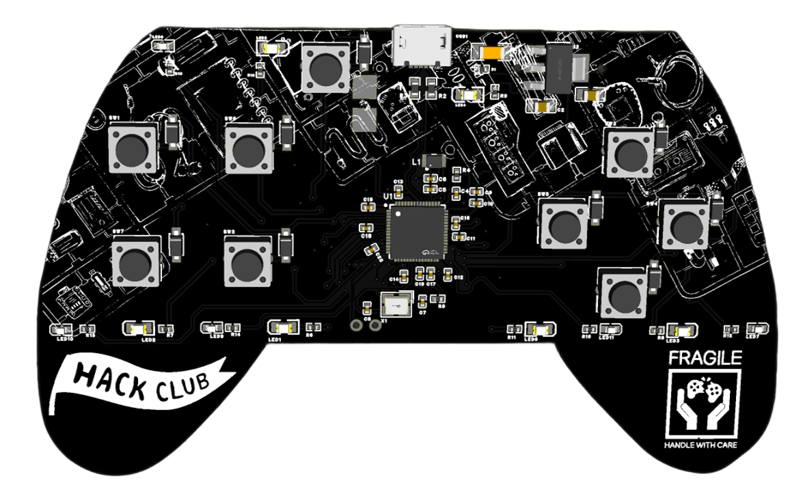
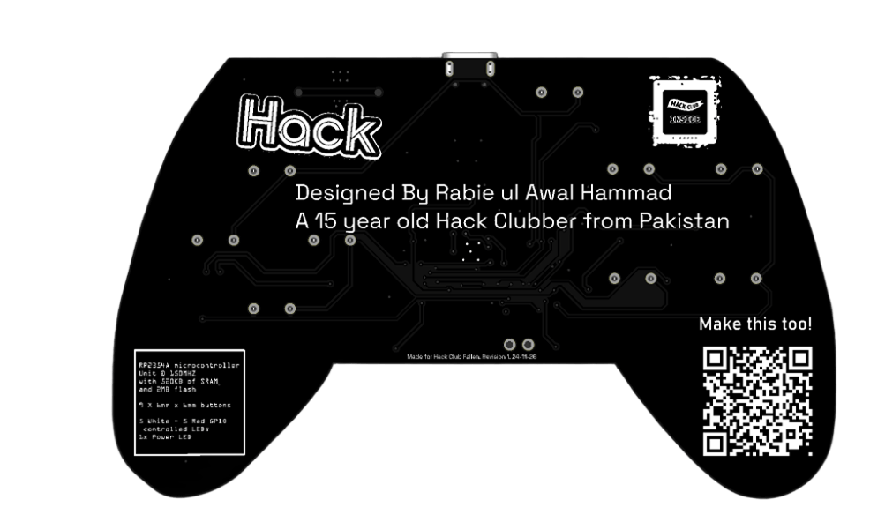

  
  

# Pico pad game controller

The PicoPad is a wired game controller powered by a RP2354A and contains 9 buttons and 11 leds. The controller will be plug and play and be able to control 10 leds independently all while using less then 500 milliamps which makes it compatible to use with older usb 2.0 devices.

## How to use this?

###### Ordering the PCB.

Look at the [Fabrication Files](Fabrication%20files) folder you should be able to see the the Gerbers, Pick and Place files and BOM_PCB. Look at the latest revision which at the time of me writing is V1 but it may be different later.

After you have the files you can send them to any manufacturer which can give you the PCB and PCBA. You can skip buying PCBA if you have the equipment and skills for soldering 0402 and QFN-58 packages. But it is highly recommended for beginners to get PCBA or have a experienced person who has the specialist equipment to solder it for you.

###### Flashing the firmware.

We will be using the ardunio IDE to flash our board. for that we will use <a href="https://github.com/earlephilhower/arduino-pico"> Ardunio Pico GitHub </a> 

**Step 1**
Open Arduino Ide and go to File and then prefrences from there you should be able to add 
`https://github.com/earlephilhower/arduino-pico/releases/download/global/package_rp2040_index.json` 
After that you should be able to see the PICO in a baord manager.

**Step 2**
You will be able to find the Firmware in the repo in the [Firmware](Firmware) folder. Open that code in the Arduino IDE.

**Step 3**
Plug in the board while shorting the BOOT_SEL pad near the bottom left of the USB port. When you plug in your PCB the IDE should recognise it and you will be able to upload your code.

### Why I made this.

This is a side project I made for Hack Club Fallen. If you don't know Hackclub is a global community of teen builders and makers which build a lot of cool stuff. Fallen is a program which is/was ran by Hack Club where you have to make hardware to attend the maker fare in Shenzen!

The requirements required me to have a working project which I can demo at the event so I made this while the schematic of my main project got reviewed so I made this. I also plan to give the extra PCBs to attendees at the event as a gift!

### BOM

| ITEM | Price | NOTE |
| --- | --- | --- |
| PCB | $5| 10 X PCBs |
| PCBA | $102 | All parts included |
| Delivery | $45| Delivery |

**NOTE this is not the full BOM please look at [BOM.CSV](BOM.csv) here!**

### Files

[Fabrication Files](Fabrication%20files) includes the gerbers, Pick and Place and the PCB BOM

[SCHEMATIC](Schmatic.pdf)  *According to the reqss for fallen*

[ALL external assets used](Assets%20used)

[Images in the readme](images)

[3D model of the PCB](3D%20model)

This repo has all the files needed to replicate this design. If you find that I did anything wrong or am missing something I will love to make the changes required.

*Made by love from Rabie ul Awal Hammad. Age:15 from Pakistan.*

### &#x20;

